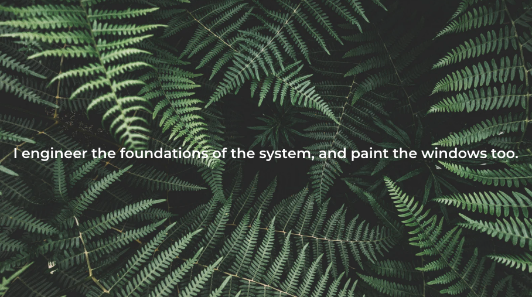

<!-- 

  

 -->

  CS Grad • Software Engineer • Web Developer • Indie Game Developer

---

<strong>Tools of My Trade</strong>

  <!-- Languages & Frameworks -->
  
  
  
  
   
   
   
    
   
   
   
   
   
  
  
   
  
  
   
   
   
  
  
  
   
   
   
  
  
  
  
  
  
  
  
  
  
  
  
  
  
  
  

---

<strong>Things I've Built</strong>

<a href="https://github.com/UccelloLibero/Atlas-Quest-by-Dark-Toothful">Atlas Quest</a> A story-driven 2D platformer built in Godot where players unlock animal companions while learning environmental trivia.

<a href="https://github.com/UccelloLibero/Antipode">Antipode</a> A web application that finds your point on the exact opposite side of the Earth using Flask, CeleniumJS, and map coordinates.

<a href="https://github.com/UccelloLibero/Flagship">Flagship</a> A fast-paced flag guessing game built with Flask, Wikipedia API and the WebShare API. Learn global flags under a countdown.

<a href="https://github.com/UccelloLibero/Stochasticity">Stochasticity</a> Responsive web applicaiton showcasing random images paired with biology-themed messages built with Python, Flask, JavaScript, AJAX.

<a href="https://laravel-chirper-main-gh6dbt.laravel.cloud">Chirper</a> A full-stack microblog platform built with Laravel, Tailwind, and Vite. Implements authentication, database migrations, markdown support, favoriting, and shareable per-chirp links.

<!--
**UccelloLibero/UccelloLibero** is a ✨ _special_ ✨ repository because its `README.md` (this file) appears on your GitHub profile.

Here are some ideas to get you started:

- 🔭 I’m currently working on ...
- 🌱 I’m currently learning ...
- 👯 I’m looking to collaborate on ...
- 🤔 I’m looking for help with ...
- 💬 Ask me about ...
- 📫 How to reach me: ...
- 😄 Pronouns: ...
- ⚡ Fun fact: ...
-->
